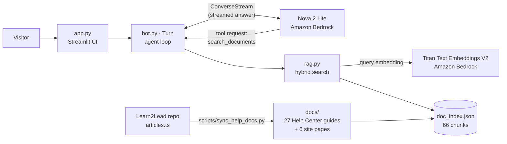

# Design decisions

Why the Learn2Lead assistant is built the way it is, what was measured, and what I'd do next. Experiment details are in [`evals/RESULTS.md`](evals/RESULTS.md).

## Architecture

A question flows like this: the model reads it and decides whether to search; `Turn` runs the search and sends the passages back; the model answers from them while the answer streams to the page, and the sources are shown underneath.

## 1. Search is a tool the model chooses to use (agentic RAG)

The other common design searches on every question and pastes the results into the prompt. I made search a tool instead because:

- **Questions that don't need the documents skip the search.** In both final evaluation runs the model searched for 28 of 32 questions. The other 4 were the 3 off-topic requests, which it declined directly, and "How many hours do I have left?", which it answered from the system prompt's rule that it can't see accounts.
- **The model writes a better search query** than the raw question. For example, it turns "I'm a parent. How do I get my kid into their class?" into a focused query.
- **The trade-off:** that query is also where the model's interpretation happens. The one remaining eval failure is decided there (see [Known limitations](#known-limitations)).

## 2. Retrieval built in plain Python instead of Bedrock Knowledge Bases

Bedrock Knowledge Bases usually needs a vector database such as OpenSearch Serverless, which charges by the hour even when idle. For 66 chunks, comparing a question with every chunk in Python takes milliseconds, and the index is a 760 KB JSON file. Building it also made every part measurable and changeable: chunking, hybrid search and ranking were all tuned with the eval suite. Past a few hundred thousand chunks, a vector database would make sense.

## 3. The knowledge comes from the source of truth

The 27 Help Center articles aren't copied by hand. `scripts/sync_help_docs.py` compiles the TypeScript file the Learn2Lead website itself uses (`src/services/help/articles.ts`) and writes Markdown, so the assistant always says what the site says. Re-running it after a Help Center change, followed by `python3 rag.py`, updates the assistant. The index also stores a **fingerprint** (a hash of every document and the chunk settings) and rebuilds itself when anything changes, so a stale index can't be served by accident.

## 4. Retrieval settings were chosen by measurement

Hybrid search (BM25 keywords + embeddings, merged with reciprocal rank fusion), 100-word chunks and top-5 results raised evidence recall from 85% to 96%. Two well-known techniques, contextual chunk headers and section-aware chunking, were tested and **rejected** because they made retrieval worse on these documents. Both remain as off-by-default settings so the results can be reproduced.

## 5. The model was chosen by evaluation, not by price per token

| Model | Accuracy | Cost per question | Why not |
|---|---|---|---|
| **Nova 2 Lite** | **98%** | $0.0012 | Chosen |
| Nova Micro | 91% content | $0.0001 | Shows `<thinking>` tags in every answer |
| Nova Pro | 94% content | $0.0020 | Shows `<thinking>` tags; costs more |
| Llama 4 Scout | — | — | Doesn't support tool use when streaming |

## 6. One tool, not three

The earlier version also had a clock and a calculator. A support assistant doesn't need them, and tool definitions are sent with every request: removing the two saved **180 input tokens per model call (13%)**, and removed the chance of the model calling a tool it doesn't need.

## 7. Conversation memory

- **Web app: memory belongs to each visitor's browser session.** The terminal version saves history to a file; doing that in a web app would show every visitor everyone else's conversation.
- **History is trimmed at question boundaries, never in the middle of a turn.** A turn that used a tool is four messages (question, tool request, tool result, answer). Cutting between a tool request and its result makes Bedrock reject the next request.
- **A failed turn is rolled back completely** (`del messages[start:]`), so an error halfway through a tool call can't leave the history in a state Bedrock rejects.
- **The agent loop is capped** (`MAX_TOOL_ROUNDS = 5`), so a confused model can't loop forever and run up costs.

## 8. Cost and abuse controls

| Control | Where |
|---|---|
| `MAX_TOKENS = 300` caps each answer (output tokens are the expensive ones) | `bot.py` |
| Question limit per session, maximum question length, optional password | `app.py` |
| Least-privilege IAM user that can only use the two models | `deploy/iam-policy.json` |
| A script that checks the demo key has exactly those permissions | `deploy/check_permissions.py` |
| AWS budget alert | AWS account |
| Adaptive retries and cached query embeddings, added after hitting `ThrottlingException` | `bot.py`, `rag.py` |

## 9. Testing: unit tests and evaluations are separate

- **Unit tests (`pytest`, 43 tests)** never call AWS. A fake Bedrock client replays recorded event streams, and a guard fixture fails any test that reaches the real client. They run in under a second in CI on every push, at no cost.
- **Evaluations (`evals/`)** call real models, cost about $0.05 per run, and give slightly different results each time. They're run on purpose when something changes, and every result is saved.

The two answer different questions: tests check that the code does what I wrote; evals check whether what I wrote actually works for users.

## Known limitations

- **Ambiguous questions:** "How do I get my kid into their class?" is read as *enroll* in about half of runs, instead of *join today's class*. A fix to try: ask a short clarifying question when two guides match equally well.
- **The judge can be wrong.** Every failure was read by a person, and one judge reason was mistaken. A larger evaluation set would need spot checks of passing answers too.
- **32 questions is a small set.** Changes of 1–2 questions are within run-to-run variation, which is why final results are reported over two runs.
- **The question limit is per browser session**, so it resets on reload. The password, the budget alert and the restricted IAM user are the real protections.
- **The demo can't answer account questions** ("How many hours do I have left?"). That's deliberate (see next steps).

## Next steps

1. **Account questions through read-only tools** (hours left, next class), querying Supabase as the signed-in user so row-level security limits each user to their own data. Many students are minors, so this needs a decision about what the model may see, and an update to the privacy policy, before any personal data is sent to a model.
2. **Embed the assistant in the Learn2Lead site**, calling Bedrock from a Supabase Edge Function. The design carries over: the agent loop, trimming, rollback and cost tracking are the same ideas in TypeScript.
3. **Remove `<thinking>` blocks from the stream** and re-run the eval with Nova Micro: 91% content accuracy at about 1/12 of the cost.
4. **Re-sync the documents automatically** with a scheduled CI job that runs the sync script and opens a pull request when the Help Center changes.
5. **Multi-turn evaluation**: today every eval question starts a new conversation.
