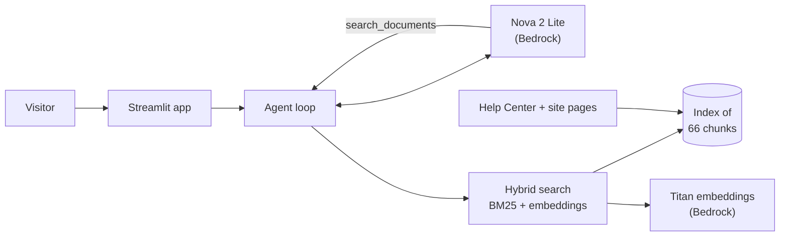

# Learn2Lead Assistant

[](https://github.com/Rusheekb/aws-chatbot/actions/workflows/ci.yml)

An AI assistant for [Learn2Lead](https://learn2lead.page), a live one-on-one online tutoring platform. It tells new visitors what Learn2Lead offers and helps students, parents and tutors use the site, answering from the site's own content with Amazon Bedrock.

**98% accuracy on a 32-question evaluation · about $0.001 per question · 43 offline tests in CI**

## What it does

- Answers questions about tutoring, subjects, pricing and how the site works, using 27 Help Center guides and 6 website pages, and shows its sources.
- Streams answers in a web app (Streamlit) or the terminal.
- Declines off-topic requests (including homework), says when the documents don't cover something, and never pretends to see anyone's account.

## How it works



The model decides when to search Learn2Lead's documents (agentic RAG). Search combines keyword matching (BM25) with meaning-based matching (Titan embeddings), merged with reciprocal rank fusion. The Help Center guides are generated from the Learn2Lead website's own source code, so the assistant says exactly what the site says.

More detail on every decision: [DESIGN.md](DESIGN.md).

## Results

Measured with an evaluation suite of 32 questions: retrieval metrics, plus every answer graded against a reference answer by a separate model. Every failure was also reviewed by hand.

| | Baseline | Final |
|---|---|---|
| Answer accuracy | 88% | **98%** (average of 2 runs) |
| Retrieval: right document found | 96% | **100%** |
| Retrieval: answer text found | 85% | **96%** |
| Cost per question | $0.0010 | $0.0012 |

What made the difference, and what didn't (including two popular techniques that made things worse) is in [evals/RESULTS.md](evals/RESULTS.md).

## Tech stack

Python · Amazon Bedrock (Nova 2 Lite, Titan Text Embeddings V2) · boto3 · Streamlit · pytest · Ruff · GitHub Actions

## Run it locally

1. Create and activate a virtual environment:
   ```bash
   python3 -m venv venv
   source venv/bin/activate
   pip install -r requirements-dev.txt
   ```
2. Copy `.env.example` to `.env` and add AWS credentials for an account with access to Nova 2 Lite and Titan Text Embeddings V2 in Bedrock.
3. Start the web app (the search index builds on first run):
   ```bash
   streamlit run app.py
   ```
   Or chat in the terminal: `python3 chatbot.py`

## Tests and evaluation

```bash
pytest                                       # 43 tests, no AWS calls, under a second
ruff check .                                 # lint
python3 -m evals.run_eval --retrieval-only   # retrieval metrics, almost free
python3 -m evals.run_eval --label my-run     # full evaluation, about $0.05
```

## Updating the assistant's knowledge

```bash
python3 scripts/sync_help_docs.py ../Learn2Lead   # regenerate docs/help from the website's source
python3 rag.py                                     # rebuild the search index
python3 rag.py "how much does tutoring cost?"      # try a search
```

The index also rebuilds itself whenever a document or a search setting changes.

## Project structure

```
app.py               Streamlit web app (password, question limits, sources)
chatbot.py           Terminal version
bot.py               Agent loop: streaming, tool calls, memory, cost tracking
tools.py             The search_documents tool
rag.py               Chunking, embeddings, hybrid search, self-updating index
system_prompt.txt    The assistant's instructions
docs/                Knowledge base: help/ (generated) and site/ pages
evals/               Questions, runner, saved results, RESULTS.md
tests/               Unit tests with a fake Bedrock client
scripts/             Help Center sync from the Learn2Lead repo
deploy/              Least-privilege IAM policy, permission check, deployment guide
```

## Deploying

See [deploy/DEPLOY.md](deploy/DEPLOY.md) for running a password-protected demo on Streamlit Community Cloud with a restricted AWS user.

## Configuration

Settings are read from `.env`; all are optional except the AWS credentials. See [.env.example](.env.example).

| Setting | Default | Description |
|---|---|---|
| `MODEL_ID` | `global.amazon.nova-2-lite-v1:0` | Bedrock chat model |
| `MAX_TOKENS` | `300` | Maximum answer length |
| `MAX_TURNS` | `3` | Question/answer pairs remembered |
| `MAX_CHUNK_WORDS` / `TOP_K` / `SEARCH_MODE` | `100` / `5` / `hybrid` | Search settings, chosen by evaluation |
| `APP_PASSWORD` | none | Password for a public demo |
| `MAX_QUESTIONS_PER_SESSION` | `20` | Questions per visitor session |
